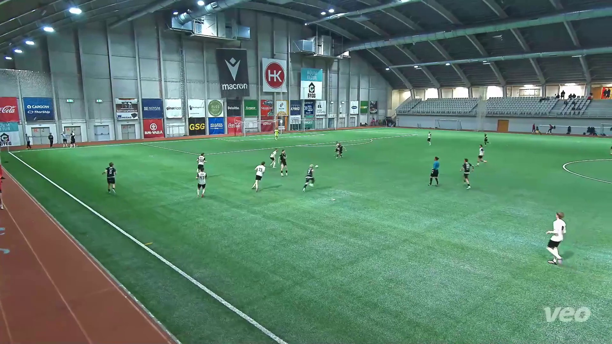
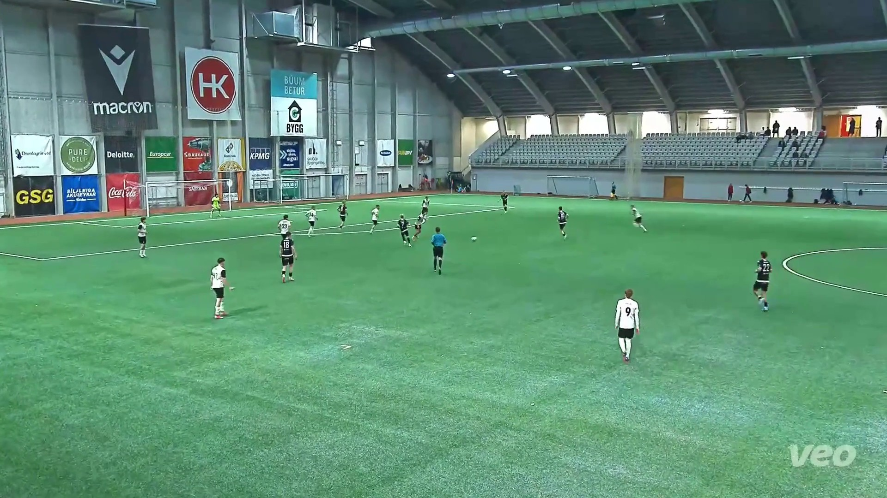
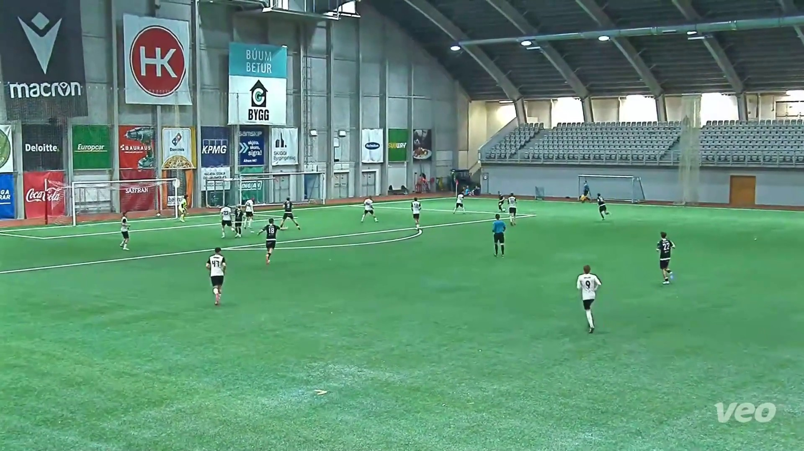

# Football Frame Annotation

A Python-assisted workflow for organizing football match frames, identifying visually similar images, and generating preliminary object annotations for computer vision tasks.

This repository contains Python utilities and workflow documentation developed during a football match frame annotation project involving thousands of manually reviewed and annotated frames.

## Project Overview

The project involved preparing and annotating football match frames for potential computer vision applications. The workflow combined image processing, visual similarity matching, AI-assisted pre-annotation, and manual annotation using LabelMe.

The annotation process covered thousands of football match frames, which were individually inspected and annotated.

## Tools & Technologies

- **Python:** Image processing and workflow automation.
- **CLIP (Sentence Transformers):** Visual similarity matching and image grouping.
- **YOLOv8:** AI-assisted object detection and preliminary annotation.
- **OpenCV:** Image reading and processing.
- **LabelMe:** Manual image annotation and verification.

## Repository Contents

| File | Description |
|---|---|
| `split_images.py` | Organizes images into sequential batches, with a default batch size of 200. |
| `image_sort.py` | Uses CLIP embeddings and cosine similarity to identify and group visually similar images. |
| `yolo_preannotation.py` | Uses YOLOv8 to generate preliminary bounding-box annotations in LabelMe-compatible JSON format. |

## Annotation Categories

The annotation project covered the following object categories:

- `player1` and `player2`
- `goalkeeper1` and `goalkeeper2`
- `referee`
- `ball`
- `pitch`
- `goalbox`

The player and goalkeeper labels distinguish the two opposing teams. The `goalbox` label was used for goalpost annotations.

## Workflow

### 1. Image Batching

Football match frames were organized into manageable groups of 200 images using `split_images.py`.

### 2. Image Similarity Matching

CLIP image embeddings were used to compare frames against reference images. This helped identify and group visually similar frames, including frames from matches with similar team jerseys.

### 3. AI-Assisted Pre-Annotation

YOLOv8 was used to generate preliminary bounding-box annotations for detected people and sports balls.

The generated annotations were mapped to the LabelMe JSON format. Since the model did not independently distinguish between teams, goalkeepers, and referees, its predictions required further review and correction.

### 4. Manual Annotation and Verification

Every annotated image was individually inspected in LabelMe.

The manual review involved correcting object labels based on jersey characteristics and player movements, as well as annotating the referee, ball, pitch, and goalposts.

This human verification stage was essential to ensuring that the final annotations reflected the intended labeling scheme.

## Sample Annotation Results

The following examples demonstrate the bounding-box annotations and object labeling performed during the project. Each image is accompanied by its corresponding LabelMe JSON annotation file.

### Sample 1



[View LabelMe JSON](examples/sample_annotations/000a410cbde24a8398cb4bee8aeacc_f0015.json)

### Sample 2



[View LabelMe JSON](examples/sample_annotations/000a410cbde24a8398cb4bee8aeacc_f0118.json)

### Sample 3



[View LabelMe JSON](examples/sample_annotations/000a410cbde24a8398cb4bee8aeacc_f0220.json)

## Installation

Clone the repository:

```bash
git clone https://github.com/francis-anyaora/football-frame-annotation.git
```

Navigate into the project directory:

```bash
cd football-frame-annotation
```

Install the required Python packages:

```bash
pip install -r requirements.txt
```

LabelMe can be installed separately for reviewing and editing annotations:

```bash
pip install labelme
```

## Usage

Run the scripts from the project root directory.

**Split images into batches:**

```bash
python scripts/split_images.py --source "path/to/images" --destination "path/to/output" --batch-size 200
```

**Find visually similar images using CLIP:**

```bash
python scripts/image_sort.py --main "path/to/main" --guide "path/to/guide" --output "path/to/matched" --threshold 0.88
```

**Generate preliminary LabelMe annotations using YOLOv8:**

```bash
python scripts/yolo_preannotation.py --image-dir "path/to/images"
```

The scripts accept additional command-line options for configuring their operations. Run each script with `--help` to see the available options.

## Important Notes

- The image batching and CLIP matching scripts move files rather than copy them. Keep backups before running them.
- CLIP similarity scores indicate visual similarity, not a guaranteed match or team identity.
- YOLOv8 annotations are preliminary predictions and should be reviewed by a human annotator.
- Existing LabelMe JSON files are skipped by the YOLO script unless the `--overwrite` option is supplied.
- Model weights may be downloaded automatically when the scripts are first run.

## License

This project is licensed under the MIT License. See the [LICENSE](LICENSE) file for details.

The license applies to the project's original code and does not grant rights to third-party football footage, images, or datasets.
